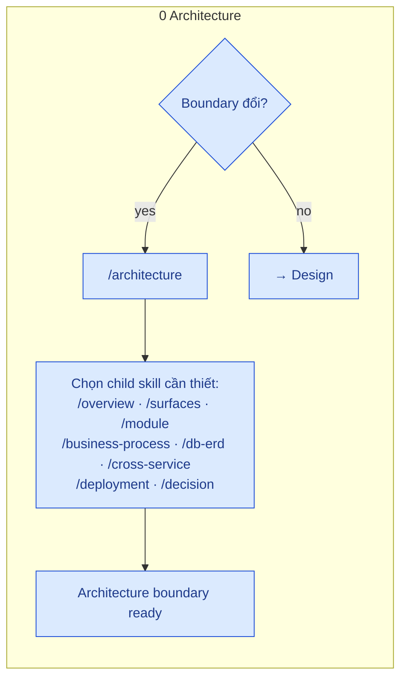
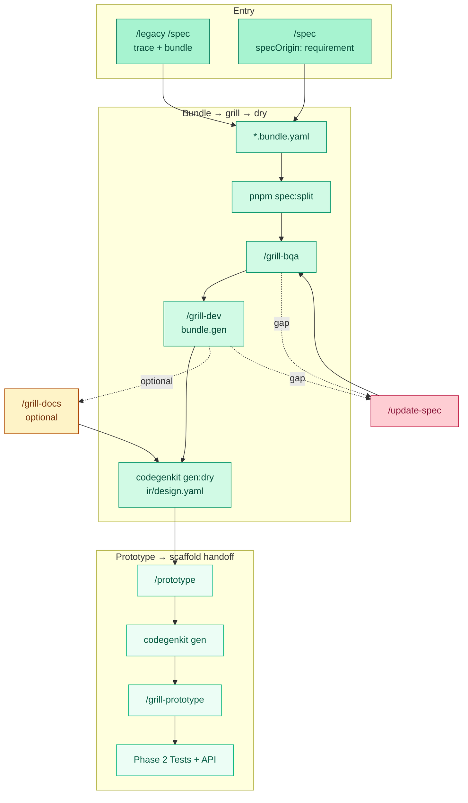

# Design phase — Pipeline cycle

> Chi tiết **Phase 1** · Overview màu: [FULL-CYCLE-PIPELINE-DIAGRAM](./FULL-CYCLE-PIPELINE-DIAGRAM.md) · Hub: [Toolchain index](./index.md)

Diagram tách nhỏ: [FEATURE-ARTIFACT-GRILL](./FEATURE-ARTIFACT-GRILL.md) · [FEATURE-ARTIFACT-BUNDLE-IR](./FEATURE-ARTIFACT-BUNDLE-IR.md)

Gam màu Design = **emerald** (khớp full-cycle). Architecture gate = **blue** (Phase 0).

---

## Architecture gate (Phase 0 — trước Design khi cần)

Chỉ chạy khi **overview / surface / module / business-process boundary** thay đổi hoặc cần integration/deployment mới. Skip nếu các mapping này đã ổn định.

Skills: `/architecture` router · `/overview` · `/surfaces` · `/module` · `/business-process` · `/deployment`. Product `FLOW-*`: `architecture/03-business-process/`.

---

## Design cycle (Phase 1)

Tint trong gam emerald: **Entry** đậm hơn · **Core** giữa · **Out** nhạt hơn · optional grill-with = amber (không phải bước default) · gap = rose.

---

## Ma trận lệnh

| Lệnh | Artifact |
|------|----------|
| `/architecture` … (Phase 0) | Overview, surfaces, modules, `architecture/03-business-process/FLOW-*`, deployment/ADR — không bundle Code |
| `/legacy /spec` | Platform DNA `/legacy` + Docskit `/spec` → legacy-dynamics + bundle.legacy |
| `/spec` | bundle design v1, `specOrigin: requirement` |
| `/grill-bqa` | Inventory UI vs common; AskQuestion / `qa/open` |
| `/grill-dev` | `bundle.gen` + 01 `action` → split `ir/design.yaml` |
| `/grill-docs` | Reconcile — **không** default |
| `/prototype` | Đọc **`ir/design.yaml`** (Codegenkit FE) |
| `/qa-resolve` | Đóng `qa/open/QA-…` |
| `pnpm docs:render` | `ir/spec.yaml` → `ir/generated/` + `qa/index.md` |
| `pnpm docs:publish` | `CATALOG.md` + README (GitHub) |

## Lệnh script (design phase)

Xem [FEATURE-ARTIFACT-COMMANDS](./FEATURE-ARTIFACT-COMMANDS.md).

## Tag & gap (phase này)

| Doc | Khi nào đọc |
|-----|----------------|
| [TECH-DEBT-FLOW](./TECH-DEBT-FLOW.md) | Grill defer câu hỏi → `#tech-debt:{id}` · step 0 mỗi grill |
| [UPDATE-SPEC-FLOW](./UPDATE-SPEC-FLOW.md) | Gap sau grill/prototype → `#update:*` |
| [FEATURE-ARTIFACT-GRILL](./FEATURE-ARTIFACT-GRILL.md) | Chuỗi bqa → dev → dry |

Grill step 0 (nhẹ): Module đã map đúng surface, business-process và deployment chưa? Missing → Phase 0 `/architecture` để route tới `/surfaces`, `/module`, `/business-process` hoặc `/deployment`; không bịa hierarchy trong bqa.

Sau `portal:gen:dry` pass → [Portal reference](https://github.com/raintr91/nuxt_4/blob/nuxt_v_3/docs/operational/PORTAL-CODEGEN.md) · [NEEDS-COMPONENT-FLOW](./NEEDS-COMPONENT-FLOW.md) (`#needs-component` trong `/prototype`).
