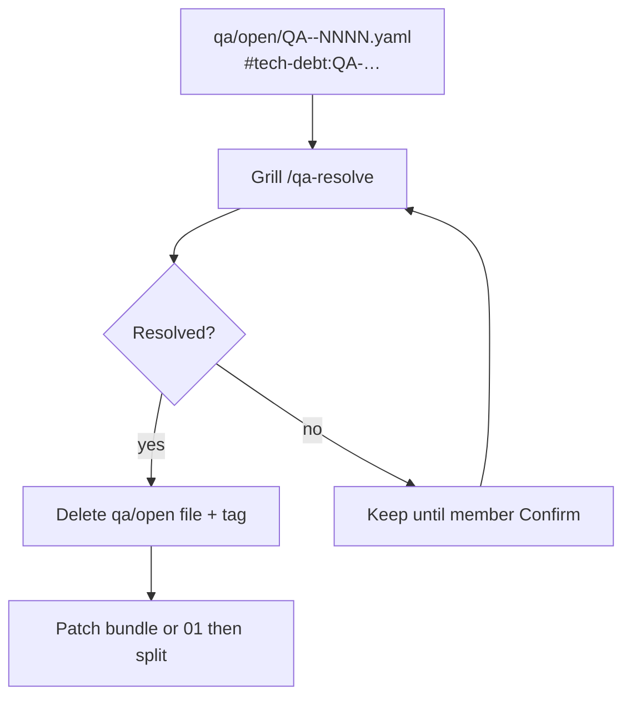

# Tech debt flow



## Spec shape

**Không** `openQuestions` trên bundle. Treo:

```yaml
# qa/open/QA-cmp-adm-002-02-01-02-0001.yaml
id: QA-cmp-adm-002-02-01-02-0001
kind: tech-debt
target:
  path: product/surfaces/…/<slug>.bundle.yaml
question: |
  Full permission matrix?
```

Trên design/01: `#tech-debt:QA-cmp-adm-002-02-01-02-0001` — **cùng id** với file inbox. Đóng: `/qa-resolve QA-…` + solution.

## vs `#update:*`

| | `#tech-debt:QA-…` | `#update:*` |
|---|-------------------|-------------|
| Meaning | Chưa chốt — file `qa/open` | Delta đã Confirm |
| Cleared | `/qa-resolve` | `/update-spec` / wire |

## Grill

- `/grill-bqa` · `/grill-dev` · `/grill-docs` · `/grill-api-spec` — re-ask QA còn mở.
- Không invent field; Other chưa chốt → file QA.

## Liên kết

| Doc | Nội dung |
|-----|----------|
| [FEATURE-ARTIFACT-GRILL](./FEATURE-ARTIFACT-GRILL.md) | AskQuestion + inbox |
| [UPDATE-SPEC-FLOW](./UPDATE-SPEC-FLOW.md) | `#update:*` sau khi chốt |
| [DESIGN-PHASE-DIAGRAM](./DESIGN-PHASE-DIAGRAM.md) | Gap loop |
